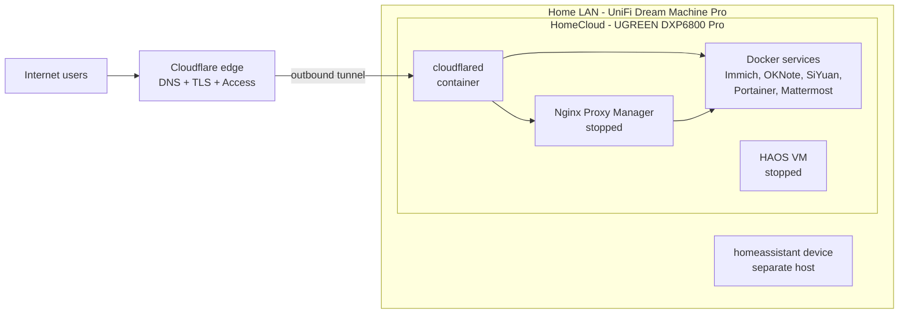

# home-nas-infrastructure

> **Public edition.** Family member names, the real domains (shown as `example.com`, old one as `example.net`) and some security settings are replaced with placeholders. The full version is kept privately.

Operational memory for the family home lab: the UGREEN NAS **HomeCloud**,
its Docker services and VM, the UniFi network, and the domain
**example.com** published through Cloudflare Tunnel and Nginx Proxy Manager.

This repository is the **source of truth**. Humans and AI agents read it before
changing anything, and update it in the same task as any change.
AI agents: start with **[AGENTS.md](AGENTS.md)**.

## Verification labels

Every fact in this repo carries one of these labels. Never treat a fact as
current without checking its label and date.

| Label | Meaning |
| --- | --- |
| `VERIFIED <date>` | Inspected directly on the system on that date |
| `USER-PROVIDED` | Stated by the owner, not inspected |
| `TO_BE_VERIFIED` | Unknown or unconfirmed; a discovery step is linked |
| `EXAMPLE` | Illustrative only, not the real configuration |

The first baseline was taken on **2026-11-11** from the UGOS Pro web UI, the
Immich API and the UniFi topology page. No shell (SSH) access was used.

## The environment at a glance

| Area | Where to look |
| --- | --- |
| What exists right now | [inventory/](inventory/) (start with [docker-services.md](inventory/docker-services.md)) |
| How it fits together | [architecture/](architecture/) |
| One folder per service | [services/](services/) |
| Network, Cloudflare, Nginx, DNS, SSL, firewall | [networking/](networking/) |
| Domains and adding a subdomain | [domains/](domains/) ([add-new-subdomain.md](domains/add-new-subdomain.md)) |
| Folders, mounts, permissions | [storage/](storage/) |
| Backup, restore, disaster recovery | [backups/](backups/) |
| Step-by-step procedures | [runbooks/](runbooks/) |
| Discovery, drift detection, validation | [scripts/](scripts/) |
| Templates for new services | [templates/](templates/) and [services/_template/](services/_template/) |
| History of changes | [CHANGELOG.md](CHANGELOG.md) |

## Services

Machine-readable list: [inventory/services.yaml](inventory/services.yaml).

| Service | Kind | Host port | State | Public hostname | Status of facts |
| --- | --- | --- | --- | --- | --- |
| [immich](services/immich/) | Docker project (4 containers) | 2283 | Running | immich.example.com | VERIFIED 2026-11-11 |
| [cloudflare-tunnel](services/cloudflare-tunnel/) | Docker | none | Running | is the entry point | VERIFIED 2026-11-11 (routes TO_BE_VERIFIED) |
| [nginx-proxy-manager](services/nginx-proxy-manager/) | Docker | 80, 81, 443 | Running (started 2026-11-11, auto-restart off) | serves the old domain only | VERIFIED 2026-11-11 |
| [portainer](services/portainer/) | Docker | 9000, 8000 | Running | portainer.example.com (public, see warning) | VERIFIED 2026-11-11 |
| [mattermost](services/mattermost/) | Docker project (2 containers) | 8401 | Running (started 2026-11-11) | mattermost.example.com | VERIFIED 2026-11-11 |
| [oknote](services/oknote/) | App Center app (Docker) | 38080 | Running | oknote.example.com | VERIFIED 2026-11-11 |
| [siyuan](services/siyuan/) | App Center app (Docker) | 6806 | Running | siyuan.example.com | VERIFIED 2026-11-11 |
| [home-assistant](services/home-assistant/) | KVM VM "HAOS" on the NAS + separate device | 8123 | VM stopped | ha.example.com (502 while HA is down) | VERIFIED 2026-11-11 |
| [dashboard](services/dashboard/) | Docker project (Homepage) | 3010 | Running | dashboard.example.com (Cloudflare Access login) | VERIFIED 2026-11-11 |

## Quick access (phone and laptop)

| What | At home | Away from home | Phone app |
| --- | --- | --- | --- |
| **Dashboard (start here)** | `http://192.168.0.119:3010` | `https://dashboard.example.com` (Cloudflare Access login) | browser, add to home screen |
| NAS itself (UGOS) | `http://192.168.0.119:9999` | UGREEN NAS app (remote access documented privately) | UGREEN NAS |
| Immich | `http://192.168.0.119:2283` | `https://immich.example.com` | Immich |
| OKNote | `http://192.168.0.119:38080` | `https://oknote.example.com` | browser |
| Mattermost | `http://192.168.0.119:8401` | `https://mattermost.example.com` | Mattermost |
| SiYuan | `http://192.168.0.119:6806` | `https://siyuan.example.com` | browser |
| Home Assistant | `http://homeassistant.local:8123` | HA Cloud, VPN or a hostname | Home Assistant |
| Portainer | `http://192.168.0.119:9000` | `https://portainer.example.com` (public: add Cloudflare Access) | browser |
| NPM admin | `http://192.168.0.119:81` | VPN only, never published | browser |

Details per service: the **Access from a phone or laptop** section of each `services/<name>/README.md`.
A home VPN (UniFi WireGuard or Teleport on the Dream Machine Pro) is not set up yet (TO_BE_VERIFIED).

## The one rule

> **No infrastructure change is complete until this repository is updated,
> validated (`make check` or `python3 scripts/check_docs.py`) and committed.**

Details in [AGENTS.md](AGENTS.md) and [CONTRIBUTING.md](CONTRIBUTING.md).

## Security

- The repository must stay **private**. It describes the home network.
- No secrets in git: passwords, tokens, keys and tunnel credentials live only on
  the NAS (`.env` files next to compose files) and in the owner's password manager.
- `scripts/check_docs.py` and the GitHub `validate` workflow scan for secrets on every push.
