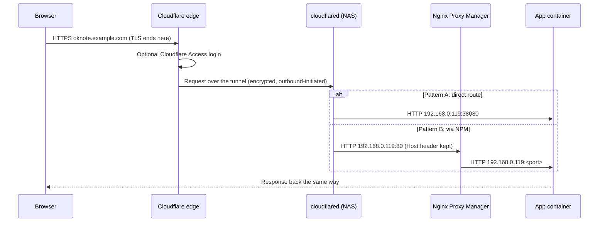

# Domain routing

| Hop | Protocol | TLS? |
| --- | --- | --- |
| Browser -> Cloudflare | HTTPS | Yes, Cloudflare edge certificate |
| Cloudflare -> cloudflared | Tunnel (QUIC/HTTP2) | Yes, tunnel encryption |
| cloudflared -> NPM / app | HTTP on LAN | No (stays inside the NAS/LAN) |
| NPM -> app | HTTP on LAN | No |

Which pattern is live: `TO_BE_VERIFIED` (NPM is stopped, so routes must currently
go direct). Full guide: [domains/](../domains/README.md).
