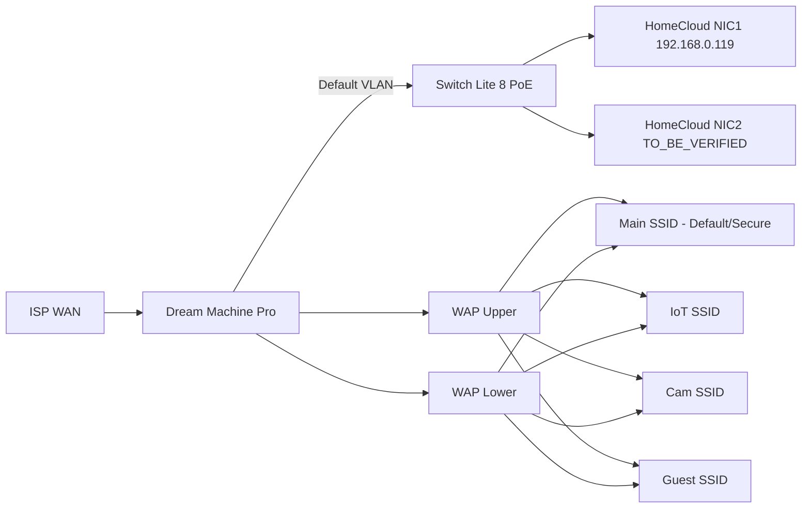

# Network architecture

| Topic | State | Where documented |
| --- | --- | --- |
| VLAN names | VERIFIED 2026-11-11 | [inventory/network-inventory.md](../inventory/network-inventory.md) |
| Subnets, DHCP ranges, reservations | TO_BE_VERIFIED | [networking/unifi](../networking/unifi/README.md) |
| Inter-VLAN firewall rules | TO_BE_VERIFIED | [networking/firewall](../networking/firewall/README.md) |
| Port forwards | TO_BE_VERIFIED (expected none) | [networking/firewall](../networking/firewall/README.md) |
| DNS (UDM, local records) | TO_BE_VERIFIED | [networking/dns](../networking/dns/README.md) |
| NAS firewall | Documented privately | [networking/firewall](../networking/firewall/README.md) |

Design intent (recommended):
- NAS on Default (or Secure); IoT and cameras isolated; Home Assistant allowed to
  reach IoT; Guest isolated from everything.
- DHCP reservation for the NAS at 192.168.0.119 (tunnel routes depend on it).
