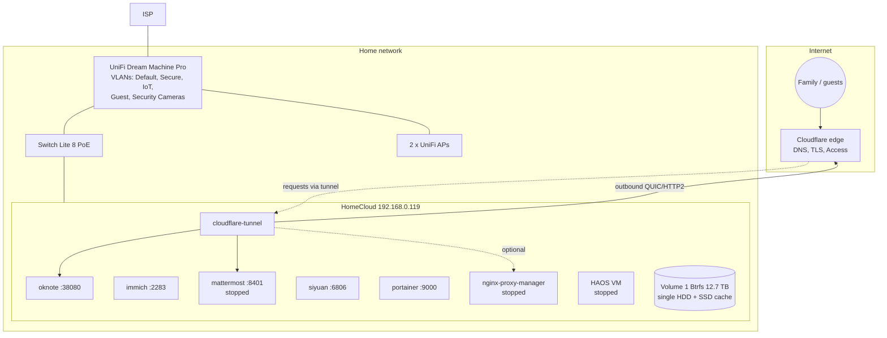

# Architecture overview

A single UGREEN NAS hosts storage, Docker services and one VM. A UniFi Dream
Machine Pro runs the home network. Selected web apps are published at
`*.example.com` through a Cloudflare Tunnel; nothing is port-forwarded.

Key properties:
- **Single point of failure**: one HDD, no RAID, no backups (see [backups/](../backups/)).
- **Outbound-only exposure**: Cloudflare Tunnel; TLS ends at Cloudflare.
- **LAN-only admin**: UGOS, Portainer, NPM admin, Immich (for now).

Details: [network](network-architecture.md), [docker](docker-architecture.md),
[domain routing](domain-routing.md), [storage](storage-architecture.md).
