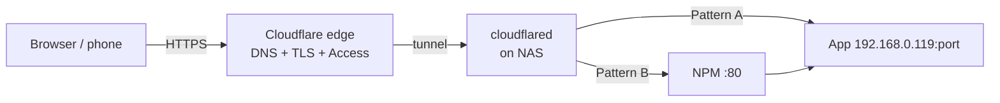

# Domains: example.com

How a public hostname reaches an app on the NAS, and how to add a new one.

| Pattern | Path | Use when | Add a subdomain by |
| --- | --- | --- | --- |
| **A** | Tunnel -> app | 1 to a few apps (today, since NPM is stopped) | One public hostname in the tunnel |
| **B** | Tunnel `*` -> NPM -> app | Many apps, or same names on LAN | One proxy host in NPM |

Both can coexist: a specific tunnel hostname wins over the wildcard.

| File | Contents |
| --- | --- |
| [domain-inventory.md](domain-inventory.md) | Every hostname, target, pattern, protection |
| [add-new-subdomain.md](add-new-subdomain.md) | Step by step, worked example `oknote.example.com` |
| [cloudflare-tunnel-setup.md](cloudflare-tunnel-setup.md) | One-time zone + tunnel setup / rebuild |
| [nginx-proxy-manager-setup.md](nginx-proxy-manager-setup.md) | One-time Pattern B setup |
| [troubleshooting.md](troubleshooting.md) | 1033, 502, DNS, redirect loops, uploads |
